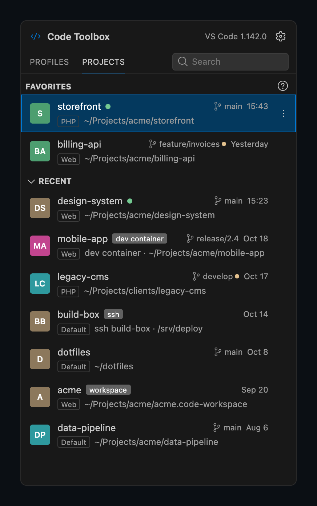
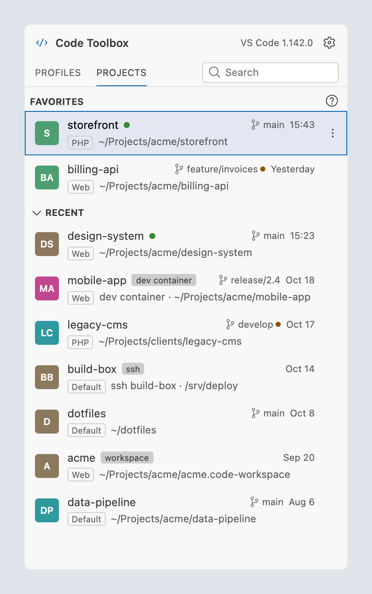
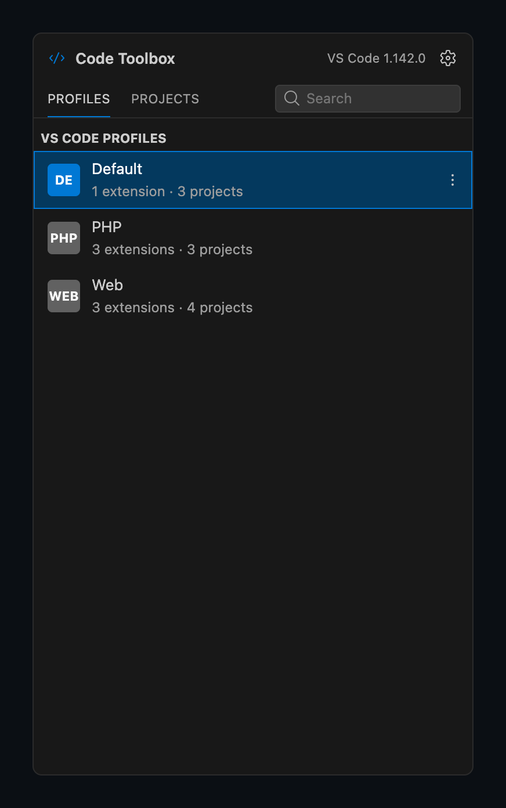
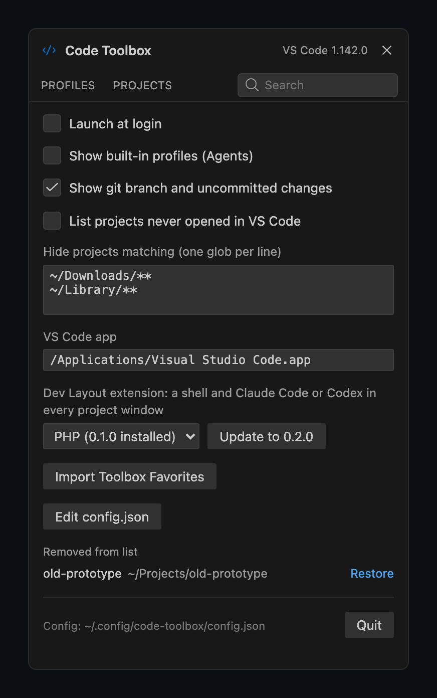

# Code Toolbox

[](https://github.com/dave-lv/vscode-toolbox/actions/workflows/build.yml)
[](https://github.com/dave-lv/vscode-toolbox/releases/latest)

**A project launcher for VS Code.** Code Toolbox lives in the menu bar (the tray on Windows and Linux) and opens
every project you've worked on in VS Code, in the right profile, with one click. It runs on macOS, Windows and
Linux.

<table>
  <tr>
    <td></td>
    <td></td>
  </tr>
</table>

## Why

VS Code's own recent list (**File → Open Recent**) lives inside a window, forgets which profile a project belongs
to, and mixes local folders with containers and SSH hosts without telling them apart. Coming from PhpStorm,
the thing missing most was Toolbox: one list of projects, always one click away, that knows how each one should
be opened. Code Toolbox is that list:

- **Every project VS Code knows about**: local folders, `.code-workspace` files, dev containers, attached
  containers, SSH and WSL remotes, newest first, with favorites pinned on top.
- **Opens each project in its own profile.** VS Code remembers which profile a folder was last used with; Code
  Toolbox reads that and opens the project there, or in another profile from the menu.
- **Shows what's going on at a glance**: the git branch, a dot for uncommitted changes, and a green dot when the
  project already has an open window (clicking it brings that window forward).
- **Fast**: the panel opens in 20–40 ms, the app is about 6 MB, and it reads VS Code's own files instead of
  keeping a database of its own.

## Features

**Projects**
- Favorites, then Recent; type to search (fuzzy).
- Click to open, ⌘-click (Ctrl-click) for a new window.
- Right-click or ⋮: Open in Profile, Open Without Dev Layout, Dev Layout Agent (Claude Code or Codex for this
  project), Close Window, Favorite, Rename, Reveal in Finder/Explorer, Copy Path, Remove from List.
- Drag favorites to reorder them. The **?** next to Favorites explains the dots.

**Profiles**
- Your VS Code profiles with their extension and project counts; click one to open a new window with it.
- ⋮: Show Projects, Show Extensions, open its `settings.json` / `keybindings.json`, Reveal Profile Folder.

<table>
  <tr>
    <td></td>
    <td></td>
  </tr>
</table>

**Keyboard** (while the panel is open; Ctrl instead of ⌘ on Windows and Linux)

| Key | Does |
|---|---|
| type | search |
| ↑ / ↓, ↩ | move, open |
| ⌘↩ | open in a profile you pick |
| ⌘1 / ⌘2 | Profiles / Projects |
| ⌘, | settings |
| Esc | clear the search, then close the panel |

**Settings (⚙)**: launch at login, checking for updates, built-in profiles, git status, listing projects you've never opened
(from `~/Documents/Projects`), globs to hide, the VS Code app (macOS), installing the dev-layout extension,
importing JetBrains Toolbox favorites.

The panel uses VS Code's own Dark Modern / Light Modern colours and follows the system's light or dark mode.

**Updates**: a while after starting and then every few hours, Code Toolbox looks for a newer release on GitHub.
When there is one, the panel offers it; **Update** downloads it, checks its signature, installs it and restarts
the app. On Linux it installs the new `.deb` or `.rpm` (asking for your password); the Arch package links to the
release instead. Turn the checks off in Settings; **Check Now** is next to it.

### The dev-layout extension

An optional VS Code extension (`vscode-dev-layout/`) that sets up each project window for working with an AI
agent: when a window with no terminals opens, it splits the terminal into a **shell** pane and an **agent** pane
and starts **Claude Code** or **Codex** there (or a command of your own), resuming the project's last
conversation. Code Toolbox comes with it: **Settings → Dev Layout extension**, pick a profile, **Install**.
Details in [The dev-layout extension](#the-dev-layout-extension-in-detail) below.

## Install

Download the latest build from **[Releases](https://github.com/dave-lv/vscode-toolbox/releases/latest)**.
The builds aren't signed with a paid certificate, so each OS warns once on first start.

| OS | File | First start |
|---|---|---|
| **Windows** 10/11 | `code-toolbox_<version>_x64-setup.exe` | "Windows protected your PC" → **More info → Run anyway**. Installs for your user only, no admin needed. |
| **macOS** 13+ (Apple silicon and Intel) | `code-toolbox_<version>_universal.dmg` | Drag it to Applications and open it. When macOS says it can't verify the app, go to **System Settings → Privacy & Security → Open Anyway**. |
| **Debian / Ubuntu** | `code-toolbox_<version>_amd64.deb` | `sudo apt install ./code-toolbox_<version>_amd64.deb` |
| **Fedora / openSUSE** | `code-toolbox-<version>-1.x86_64.rpm` | `sudo dnf install ./code-toolbox-<version>-1.x86_64.rpm` |
| **Arch / CachyOS** | `code-toolbox-<version>-1-x86_64.pkg.tar.zst` | `sudo pacman -U ./code-toolbox-<version>-1-x86_64.pkg.tar.zst` |

The dev-layout extension is installed from the app (**Settings → Dev Layout extension**). It's also
`dev-layout-<version>.vsix` on the release page, for **Extensions → ⋯ → Install from VSIX…**

On Linux, desktops whose tray only shows menus (GNOME without an AppIndicator extension) can open the panel with
`code-toolbox --toggle-panel`, e.g. from a keyboard shortcut.

## How it works

Code Toolbox reads what VS Code already keeps: its recent list and profile assignments (`storage.json`,
`state.vscdb`), its profiles (`User/profiles/`) and their extensions. It never writes to VS Code's files.

Projects are opened with the editor's own CLI. On macOS and Linux the CLI gets your login-shell environment
(a VS Code started from its CLI doesn't resolve it itself, so without this, extensions wouldn't find Homebrew,
`~/.local/bin` or OrbStack). On Windows it runs `Code.exe` with `cli.js` directly, as `bin\code.cmd` does, because
folder URIs contain `%` sequences that cmd.exe would expand.

The editor is detected: VS Code first, then Code - OSS (Arch's `code` package), Insiders, VSCodium and Cursor.

Code Toolbox's own state is `~/.config/code-toolbox/config.json` on every OS. It's hand-editable and picked up
live; a change made in the app is saved only if the file hasn't changed since it was read, otherwise it's redone
on the new contents. It can be a symlink (e.g. into a dotfiles repo): the app writes through the link and watches
its target. While the file can't be read or parsed, the app saves nothing; Settings shows the error with
**Edit** and **Reset** (which keeps the broken file as `config.json.broken`).

### The dev-layout extension in detail

When a project window with no terminals opens, it splits the terminal into a **shell** pane and an **agent**
pane and starts the agent:

| Agent (`devLayout.agent`) | Runs | Resuming (`devLayout.continueSession`, on by default) |
|---|---|---|
| **Claude Code** (default) | `claude`, which connects to the Claude Code extension on its own | `claude --continue` when the project already has a Claude conversation |
| **Codex** | `codex` | `codex resume --last`: Codex picks the folder's latest session, or starts a new one |
| **Custom** | `devLayout.agentCommand`, e.g. `gemini` or `aider` | no |

Installed from Code Toolbox into a profile that hasn't used it before, it asks in the first window whether to
turn on, and with which agent; VS Code saves the answer in that profile's settings.

**Per project**: a project's menu in Code Toolbox has **Dev Layout Agent → Claude Code / Codex**, which wins over
the profile's setting (saved as `agents` in Code Toolbox's `config.json`, so nothing is written into the
project). The profile's `agentCommand` then only applies if it's for the same agent. A trusted folder's own
`.vscode/settings.json` can set `devLayout.*` too.

- If the window reopens with the terminal showing, VS Code starts a plain shell there by itself; that untouched
  shell becomes the shell pane. Any other existing terminal means the window is left alone.
- In container and SSH windows the agent runs there. Claude's conversation check runs in the remote shell
  (honoring `CLAUDE_CONFIG_DIR` there); it's written for bash/zsh/sh/ksh, fish and PowerShell, and other shells
  get plain `claude`.
- In a folder that isn't trusted yet, nothing runs until you trust it, and the folder's own
  `.vscode/settings.json` can't turn auto-open on or change the agent or the commands.
- **Bottom panel**: the panes sit side by side, the agent on the right. **Secondary sidebar**: they're stacked,
  the agent below.

| Setting (`devLayout.*`) | Default | |
|---|---|---|
| `autoOpen` | off | Build the layout when a project window opens |
| `agent` | `claude` | `claude`, `codex` or `custom` |
| `agentCommand` | | The agent's command line, flags included: `claude --model opus`, `codex --full-auto`; required for `custom` |
| `continueSession` | on | Resume the project's last conversation (see above) |
| `shellPane` | on | Off: only the agent terminal |
| `shellCommand` | | A command for the shell pane, e.g. `git status` |
| `focus` | `agent` | Which pane has the focus once the layout is ready |
| `agentSize` | 0.7 | The agent's share of the split |
| `agentSide` | `right` | `right` (or below) or `left` (or above) of the shell |
| `sidebarWidth` | 0 | In the secondary sidebar: its width as a share of the window (e.g. 0.35); 0 leaves it alone |

Before 0.2.0 the agent was always Claude, and `agentCommand`, `agentSize` and `agentSide` were `claudeCommand`,
`claudeSize` and `claudeSide`; those names still work. **Dev Layout: Shell + Agent** in the command palette
builds the layout by hand. It logs to the "Dev Layout" output channel and to
`~/.config/code-toolbox/dev-layout.log`.

The app and the extension talk through files in `~/.config/code-toolbox/`:

| Path | Written by | Meaning |
|---|---|---|
| `config.json` → `agents` | app | The agent picked for a project (Dev Layout Agent) |
| `open/<sha1(uri)>-<pid>.json` | extension | This window is open (the green dot). Holds the extension host's start time, so a reused pid doesn't count |
| `skip-layout/<sha1(uri)>` | app | Don't build the layout on the next open (ignored after 2 minutes) |
| `close/<sha1(uri)>` | app | Close this window |

## Building from source

Built with [Tauri 2](https://tauri.app): a Rust core and a React panel in the system's web view (WebKit on macOS
and Linux, WebView2 on Windows). Needs Rust (`rustup`) and Node 22+.

```sh
make install       # build, sign, copy to ~/Applications/Code Toolbox.app and start it (macOS)
make install-ext   # package vscode-dev-layout and install it into a VS Code profile (PROFILE=PHP by default)
make test          # toolbox-core tests + TypeScript check
make dev           # the panel in a plain browser on fixture data (app/src/mock.ts): http://localhost:1420
make screenshots   # regenerate docs/images from the fixture data (needs Chrome)
```

On macOS, `make` signs the app with a local self-signed "Code Toolbox Dev" certificate when one is in the
keychain, so macOS keeps its Documents permission across rebuilds; without it the app is ad-hoc signed and macOS
asks again after each build.

More tests, and type-checking the Windows and Linux code from a Mac
(`rustup target add x86_64-pc-windows-msvc x86_64-unknown-linux-gnu` once):

```sh
cargo test -p toolbox-core -- --ignored   # real shells, the real config.json round trip
CT_TEST_FOLDER=/tmp/x cargo test -p toolbox-core --test live_editor -- --ignored   # opens + closes a real window
cargo check -p toolbox-core --no-default-features --all-targets --target x86_64-pc-windows-msvc
cargo check -p toolbox-core --no-default-features --all-targets --target x86_64-unknown-linux-gnu
```

| Folder | What |
|---|---|
| `core/` | `toolbox-core`: reading VS Code's state, the project list, `config.json`, launching the editor, git status |
| `app/src-tauri/` | The Tauri shell: tray, panel window, commands, file watching |
| `app/src/` | The panel UI (React, TypeScript); `styles.css` is its look |
| `vscode-dev-layout/` | The dev-layout extension |
| `scripts/` | Icon generation, screenshots, release helpers |
| `packaging/arch/` | The Arch / CachyOS package |

## Releasing

`.github/workflows/build.yml` tests every push and builds the macOS `.dmg` (universal), the Windows installer, the
Linux packages (`.deb`, `.rpm`, and an Arch package repackaged from the `.deb` by `packaging/arch/PKGBUILD`) and
the `.vsix`; they're the run's artifacts for 30 days. A release also gets `latest.json` and the update files the
app's updater installs (`scripts/updater-manifest.sh`).

It needs four repository secrets (Settings → Secrets and variables → Actions):

| Secret | What |
|---|---|
| `TAURI_SIGNING_PRIVATE_KEY`, `…_PASSWORD` | The key update files are signed with (`npx tauri signer generate`). Its public half is `plugins.updater.pubkey` in `tauri.conf.json`: the app installs nothing else. **Losing it means installed copies can't update any more.** |
| `APPLE_CERTIFICATE`, `APPLE_CERTIFICATE_PASSWORD` | A self-signed code-signing certificate named "Code Toolbox", base64 `.p12`. Every macOS build is signed with it, so updates keep the app's macOS permissions; `make` uses it too when it's in the keychain. It isn't Apple-verified, so macOS still asks once on first start. |

1. Bump `version` in `app/src-tauri/tauri.conf.json` (and in `vscode-dev-layout/package.json` if the extension
   changed: the app offers an update when its bundled copy is newer than the installed one), commit.
2. Tag it `v<version>` and push the tag. Its run checks the tag against `tauri.conf.json` and publishes the
   release.

`.gitlab-ci.yml` does the same on a GitLab instance with only Linux Docker runners (Windows is cross-compiled
with [cargo-xwin](https://github.com/rust-cross/cargo-xwin)); `make publish-mac` then builds the `.dmg` on a Mac
and adds it to that release, with a GitLab token in `GITLAB_TOKEN` or the keychain
(`security add-generic-password -s code-toolbox-gitlab -a "$USER" -w`).

## License

[MIT](LICENSE).

## Credits

Not affiliated with Microsoft or JetBrains. Visual Studio Code is a trademark of Microsoft; JetBrains Toolbox is
a trademark of JetBrains. Icons in the panel are [Codicons](https://github.com/microsoft/vscode-codicons)
(CC BY 4.0).
